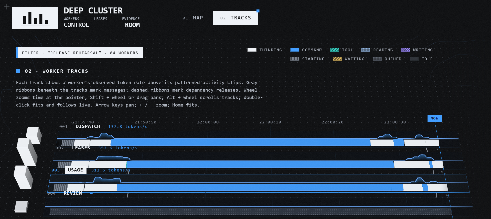

# DeepCluster

With DeepCluster, one worker can update an API while another updates its client. A reviewer can wait for both changes and check that the client calls the new endpoint correctly. Your coding agent writes the steps as a Markdown plan. DeepSeek Harness (DSH) runs the workers on your computer and sends back one report with the evidence for each check.

*Three workers are running. Review is queued until they finish. Select a column in Map to see what that worker is doing.*

## Install DeepCluster and DSH

Start with a fresh checkout of DSH `dsh-v0.2.1-rc.2`. You'll need Git, Node.js, pnpm, and a model credential. The API and workers run locally. DSH sends model requests to the provider you choose. [Build DSH and run your first worker](docs/setup.md)

## Connect your coding agent

| Supervisor | Personal skill directory | Try it in a new chat |
| --- | --- | --- |
| Cursor | `~/.cursor/skills` | `/deep-cluster` |
| Claude Code | `~/.claude/skills` | `/deep-cluster` |
| Codex | `~/.agents/skills` | `$deep-cluster` |

One installer writes the skill into the directory your tool already checks. If you use another coding tool, there's a prompt you can give its AI to set up and test the connection. [Install a skill for your coding agent](docs/agent-skills.md)

For a first task, try the [sample plan](plugin/samples/parallel-plan.md). Two read-only workers inspect the installed DeepCluster package. One lists its entry points and the other lists its tests. A reviewer then names any entry points the tests missed.

## What the scheduler does

| Feature | What you can do with it |
| --- | --- |
| Dependencies | Start independent steps together. Make a test wait for the changes it exercises. |
| Shared files and GPUs | Give each writer its own files or directory. Reserve a GPU by name so two profilers can't use it at once. |
| Run reports | See what each worker tried, which files changed, and which checks need your attention. If you lose the HTTP response, retry with the same request key to retrieve the original run. |
| Live supervision | Watch the dashboard, message a worker, or cancel a run. |
| Follow-up work | Resume a named DSH session, pin a revision of a shared protocol, or schedule one follow-up when a run finishes. |

Run DeepCluster on a computer you trust. Any local, non-browser client can submit a plan without a bearer token, and workers run with your operating-system access. File claims keep cooperating writers apart. Your coding agent still needs to check the evidence before accepting a worker's result. [Plan format, HTTP API, policy hooks, and recovery](plugin/README.md)

DeepCluster is distributed under the [MIT license](LICENSE).
